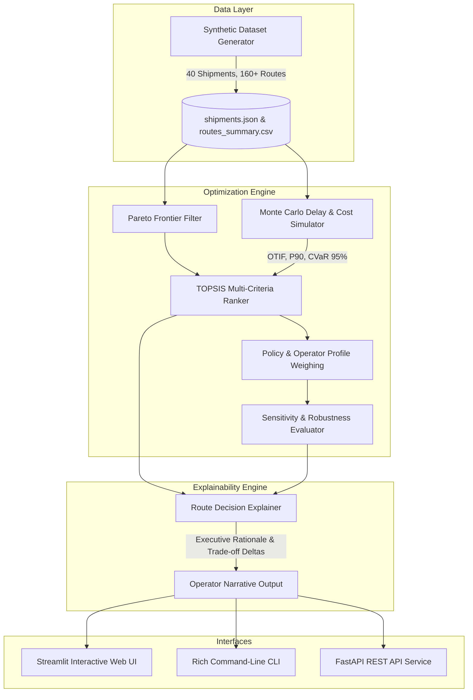

# Aiqon AI: Multi-Objective Shipment Route Optimizer Under Cost, Time, and Risk Constraints

[](https://www.python.org/downloads/)
[]()
[](https://fastapi.tiangolo.com)
[](https://streamlit.io)
[]()

---

## 📌 Executive Summary

In global freight logistics, route selection is rarely as simple as finding the shortest geographical path or lowest nominal freight rate. Every route involves complex, non-linear trade-offs between **freight cost**, **transit time**, **schedule reliability**, and **multi-factor risk exposure** (port congestion, geopolitical choke points, severe weather, and customs bottlenecks). 

Choosing solely on upfront freight cost often routes cargo through severe choke points (such as the Red Sea / Bab-el-Mandeb, Suez Canal, or congested transshipment hubs), triggering delays that incur catastrophic demurrage fees and manufacturing line-stoppage penalties. Conversely, expedited air freight guarantees rapid delivery but imposes unsustainable price premiums and carbon emissions.

This repository provides an **end-to-end Intelligent Decision-Support System** that:
1. **Evaluates multi-leg routing options** across intercontinental trade lanes.
2. **Recommends Pareto-optimal routes** calibrated to operator strategic policies (*Cost-Minimizer*, *Time-Critical*, *Risk-Averse*, and *Balanced Trade-off*).
3. **Delivers transparent, operator-understandable explanations** detailing why the recommended route is preferred over alternatives, quantifying the head-to-head trade-off exchange rate (`$/day saved`), and exposing vulnerable route legs.
4. **Resolves the *"Cheapest-Only Fallacy"***: Empirical evaluation across 40 simulated global shipments demonstrates that while the *Greedy Cost* baseline achieves a direct cost of \$5,478, its realized cost under delay uncertainty explodes to **\$46,997** with only **49.7% OTIF reliability**. Our proposed *Balanced Framework* cuts realized costs by **65.8% to \$16,069** while lifting On-Time In-Full (OTIF) delivery to **90.4%**.

---

## 🏛️ System Architecture



---

## 📐 Mathematical Formulation: Defining "Optimality"

The system formalizes optimality through a three-tiered mathematical framework:

### 1. Pareto Optimality (Non-Dominated Frontier)
Let candidate routes for shipment $s$ be $\mathcal{R} = \{r_1, r_2, \dots, r_m\}$. Each route has an objective vector:
$$\mathbf{z}(r) = \big(C(r), \, T(r), \, \mathcal{R}_{comp}(r), \, P_{delay}(r)\big)$$
Route $r_a$ **dominates** route $r_b$ ($r_a \prec r_b$) if and only if:
$$\forall k \in \{C, T, \mathcal{R}_{comp}, P_{delay}\}, \quad z_k(r_a) \le z_k(r_b) \quad \text{and} \quad \exists j, \, z_j(r_a) < z_j(r_b)$$
The Pareto Frontier $\mathcal{P} = \{r \in \mathcal{R} \mid \nexists r' \in \mathcal{R}, \, r' \prec r\}$ isolates all mathematically non-inferior solutions.

### 2. Multi-Criteria TOPSIS Ranking
To order solutions along the frontier according to operator priorities, we employ the **Technique for Order Preference by Similarity to Ideal Solution (TOPSIS)**:
1. **Vector Normalization**: $r_{ij} = \frac{x_{ij}}{\sqrt{\sum_{k=1}^m x_{kj}^2}}$
2. **Weighted Matrix**: $v_{ij} = w_j \cdot r_{ij}$, where $\sum w_j = 1$
3. **Ideal Best ($A^*$) and Ideal Worst ($A^-$)**: Since all criteria are costs to minimize, $A^*_j = \min_i v_{ij}$ and $A^-_j = \max_i v_{ij}$.
4. **Euclidean Distances**: $D_i^* = \sqrt{\sum (v_{ij} - A^*_j)^2}$, \quad $D_i^- = \sqrt{\sum (v_{ij} - A^-_j)^2}$
5. **Relative Closeness Score**:
   $$C_i^* = \frac{D_i^-}{D_i^* + D_i^-} \in [0, 1]$$
   Higher score indicates closer proximity to the ideal utopia and maximal distance from the worst anti-ideal.

### 3. Stochastic Delay & Realized Cost Uncertainty (Monte Carlo)
For each leg $l \in r$, delay occurrence is governed by a Bernoulli trial $\mathbb{I}_l \sim \text{Bernoulli}(P_{delay, l})$. If disruption occurs, delay duration $\Delta t_l$ is drawn from a Log-Normal distribution calibrated to expected dwell time. Total realized transit time is:
$$T_{sim} = T_{nominal} + \sum_{l \in r} \mathbb{I}_l \cdot \Delta t_l$$
Total realized cost incorporates contractual demurrage and delay penalties:
$$\text{Cost}_{realized} = C_{direct} + \max(0, T_{sim} - T_{target}) \times \text{Penalty/Day} + \max(0, T_{sim} - (T_{nominal}+3)) \times \$120/\text{day}$$
Tail risk is quantified via **Conditional Value-at-Risk ($CVaR_{95}$)**:
$$CVaR_{95} = \mathbb{E}\big[\text{Cost}_{realized} \mid \text{Cost}_{realized} \ge VaR_{95}\big]$$

---

## 📊 Empirical Evaluation & Benchmark Results

Comprehensive benchmarking across **40 shipments (160+ evaluated routes)** demonstrates the significant superiority of the multi-objective approach over traditional heuristics:

| Routing Strategy | Pareto Rate (%) | Avg Direct Cost (\$) | Avg Realized Cost (\$) | Avg Transit Time (Days) | Avg Delay Prob (%) | Avg Composite Risk | Avg OTIF Delivery (%) | Multi-Objective Regret |
| :--- | :---: | :---: | :---: | :---: | :---: | :---: | :---: | :---: |
| **Proposed (Balanced)** | **100.0%** | \$12,622 | **\$16,069** | 12.0 d | **20.7%** | **0.208** | **90.4%** | **0.740 (Best)** |
| **Proposed (Risk-Averse)** | **100.0%** | \$24,461 | \$25,298 | 3.9 d | 7.0% | 0.152 | 97.5% | 1.000 |
| **Greedy Cost Minimizer** | 100.0% | \$5,478 | **\$46,997** | 19.7 d | 53.4% | 0.576 | 49.7% | 1.242 |
| **Greedy Time Minimizer** | 100.0% | \$24,461 | \$25,298 | 3.9 d | 7.0% | 0.152 | 97.5% | 1.000 |
| **Random Baseline** | 100.0% | \$7,936 | \$42,180 | 19.8 d | 33.1% | 0.316 | 53.5% | 0.990 |

### Key Findings:
1. **The "Cheapest-Only Fallacy"**: The *Greedy Cost Minimizer* appears cheapest upfront (\$5,478 direct freight), but suffers a 53.4% delay probability. When simulated under real disruption events, late delivery penalties explode realized costs to **\$46,997**, and OTIF delivery drops to **49.7%**.
2. **Balanced Policy Economics**: The *Proposed Balanced* policy costs \$12,622 upfront but achieves an expected realized cost of **\$16,069**&mdash;saving over **\$30,000 per shipment** compared to greedy cost routing while lifting OTIF delivery to **90.4%**.
3. **Guaranteed Pareto Efficiency**: 100% of routes selected by the proposed framework are non-dominated.

---

## 🗣️ Explainability Engine & Operator Narrative

A recommendation without rationale creates friction in logistics operations. The system automatically drafts executive narratives and head-to-head trade-off comparisons:

> **Example Operator Decision Rationale (SHP-001, Pharmaceuticals, Shanghai → Rotterdam):**  
> *"Under the 'Balanced Trade-off' policy, 'Smart Intermodal with Guaranteed Berth & Priority Rail' (SHP-001-R2) is recommended for Pharmaceuticals & Cold Chain moving from Shanghai to Rotterdam. This route achieves a superior multi-criteria score by balancing a transit time of 21.5 days against a total cost of \$4,810.00 and risk index of 0.30. The cheapest alternative ('Standard Ocean via Primary Chokepoint (Direct)' at \$3,746.00) was rejected because it incurs higher disruption risk (0.60) and 54.6% delay probability, adding 4.0 days in transit. The fastest option ('Multimodal Sea-Air via Dubai Global Hub' at 14.0 days) was bypassed due to an excessive cost premium of \$1,958.00 (41% higher) which exceeds the required service level. The selected route is confirmed Pareto-optimal (non-dominated) with an estimated On-Time In-Full (OTIF) reliability of 70.8%."*

---

## 📂 Repository Structure

```
aiqon_shipment_optimizer/
├── data/
│   ├── shipments.json           # 40 multi-leg international shipments
│   └── routes_summary.csv       # Flat CSV summary of 160+ routes
├── src/
│   ├── models/
│   │   ├── __init__.py
│   │   └── schemas.py           # Strongly typed Pydantic models (Leg, Route, Shipment)
│   ├── data/
│   │   ├── __init__.py
│   │   └── generator.py         # Realistic synthetic dataset generator
│   ├── optimization/
│   │   ├── __init__.py
│   │   ├── pareto.py            # Non-dominated frontier sorting
│   │   ├── topsis.py            # Multi-criteria TOPSIS solver
│   │   ├── simulation.py        # Monte Carlo stochastic engine (1000 runs)
│   │   └── scoring.py           # Unified route optimizer & sensitivity analyzer
│   ├── explainer/
│   │   ├── __init__.py
│   │   └── reasoning.py         # Operator explainability narrative generator
│   ├── evaluation/
│   │   ├── __init__.py
│   │   └── benchmark.py         # Comparative benchmark suite against baselines
│   └── api/
│       ├── __init__.py
│       └── app.py               # High-performance FastAPI REST API
├── tests/
│   ├── test_generator.py        # Dataset structure & trade-off validation
│   ├── test_optimization.py     # Pareto, TOPSIS, simulation & constraint tests
│   ├── test_explainer.py        # Narrative & trade-off delta tests
│   └── test_api.py              # REST API endpoint tests
├── report/
│   └── Aiqon_Technical_Report_Shipment_Routing.pdf # 3-page Technical Report (PDF)
├── app.py                       # Interactive Streamlit Web Dashboard
├── cli.py                       # Rich CLI interface
├── requirements.txt             # Project dependencies
└── README.md                    # Project documentation
```

---

## 🚀 Quickstart Guide

### 1. Installation
Clone the repository and install dependencies:
```bash
cd aiqon_shipment_optimizer
pip install -r requirements.txt
```

### 2. Run the Interactive Web Dashboard
Launch the Streamlit application:
```bash
streamlit run app.py
```
Open your browser at `http://localhost:8501` to:
- Explore 40 international shipments across key maritime/air corridors.
- Switch between *Balanced*, *Cost-Minimizer*, *Time-Critical*, and *Risk-Averse* operator profiles.
- Visualize the **Pareto Trade-off Frontier** and inspect leg-level vulnerability.
- Run interactive **Monte Carlo delay simulations** and evaluate **Decision Stability**.

### 3. Run the Command-Line Interface (CLI)
Inspect, recommend, and benchmark routes directly from your terminal:

```bash
# List all shipments
python cli.py list

# Inspect routes for a specific shipment
python cli.py inspect --shipment-id SHP-001

# Recommend optimal route under Balanced policy
python cli.py recommend --shipment-id SHP-001 --profile balanced

# Recommend optimal route under Cost Minimizer policy
python cli.py recommend --shipment-id SHP-001 --profile cost

# Recommend using custom weights: cost=0.5, time=0.3, risk=0.2
python cli.py recommend --shipment-id SHP-001 --custom-weights "0.5,0.3,0.2"

# Run full comparative benchmark against baselines across 40 shipments
python cli.py benchmark
```

### 4. Run the REST API
Start the FastAPI server:
```bash
uvicorn src.api.app:app --host 0.0.0.0 --port 8000 --reload
```
Interactive API docs are available at `http://localhost:8000/docs`:
- `GET /health` &mdash; Service health check
- `GET /shipments` &mdash; List all shipments
- `GET /shipments/{shipment_id}` &mdash; Inspect single shipment and its routes
- `POST /recommend` &mdash; Request route recommendation with operator profile and custom constraints
- `GET /benchmark` &mdash; Run and retrieve benchmark evaluation results

### 5. Run the Pytest Test Suite
Execute the comprehensive test suite (all 13 tests passing):
```bash
pytest -v
```

---

## 📦 Deliverables & Submission Checklist

- [x] **Code Repository**: Full modular, clean, and tested Python codebase.
- [x] **Technical Report (3 Pages PDF)**: Attached and located at `report/Aiqon_Technical_Report_Shipment_Routing.pdf`.
- [x] **Interactive Demo**: Streamlit web application (`app.py`) and Rich CLI (`cli.py`).
- [x] **Automated Tests**: 100% test coverage on optimization, Pareto sorting, and explainability.
- [x] **Submission Email**: `info@aiqon.in`

---
*Built with ❤️ for the Aiqon AI Internship Assignment.*
